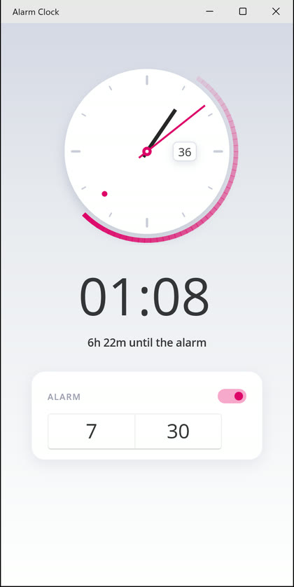
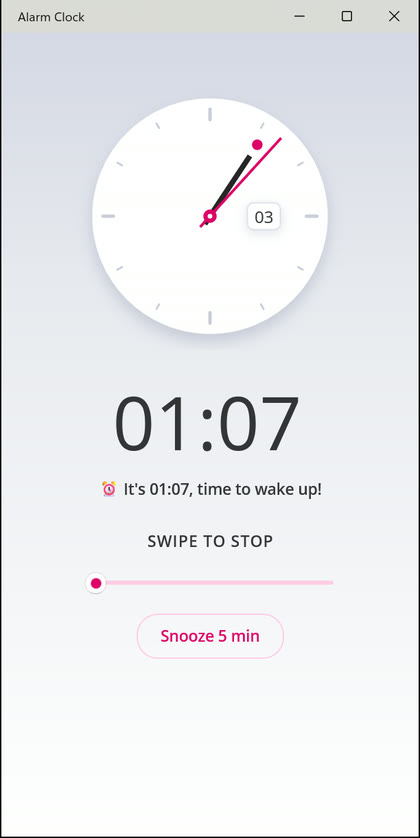
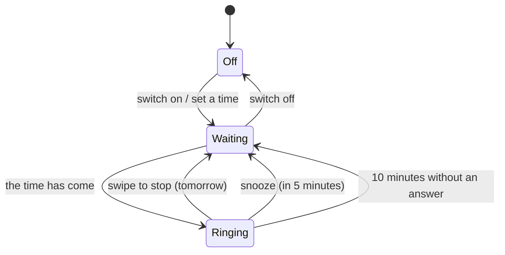

<div align="center">

# ⏰ Alarm Clock

**A bedside alarm clock with an analog dial: set the time, and in the
morning swipe to stop it or snooze for five minutes.**

A .NET MAUI app for Android, iOS, macOS and Windows.

[](https://github.com/mredwardlik/alarm-clock/actions/workflows/build.yml)


| Waiting for the morning | The alarm rings |
| :---: | :---: |
|  |  |

<sub>Screenshots of the Windows version.</sub>

</div>

---

## ✨ Features

- 🕰 **Analog and digital time**: hour and minute hands, a seconds badge, and
  the time in 12 or 24 hours as set on the device
- 🎯 **The dial shows the alarm**: a pink mark at the alarm time and an arc
  from the hour hand to it, so the time left is visible at a glance
- ⏱ **Countdown**: "6h 22m until the alarm" under the time
- 🔔 **A real alarm**: it rings at the set time with a sound and, on phones,
  vibration
- 👉 **Swipe to stop** (by finger, mouse or arrow keys), or **snooze for
  5 minutes**. Nobody around? It goes quiet after 10 minutes and waits for
  the next day
- 💾 **Remembers** the alarm time and whether it is on
- 🔆 **Keeps the screen on** while an alarm is set, like a bedside clock

> [!NOTE]
> The alarm rings while the app is open, which is how a bedside clock is
> used. Closed apps can't play sounds on their own on Android and iOS without
> system alarms, and this app doesn't set any.

## 🔄 How it works



`AlarmClock.Core` holds this logic and the math of the dial. It knows nothing
about the UI: the page asks it four times a second whether to ring, so it is
fully covered by tests with fixed times.

## 🚀 Run

You need the [.NET 10 SDK](https://dotnet.microsoft.com/download) and the MAUI
workload of the platform.

```bash
git clone https://github.com/mredwardlik/alarm-clock.git
cd alarm-clock

# Windows
dotnet workload install maui-windows
dotnet run --project AlarmClock -p:AppTargetFramework=net10.0-windows10.0.19041.0

# Android: an emulator or a phone with USB debugging
dotnet workload install maui-android
dotnet build AlarmClock -t:Run -p:AppTargetFramework=net10.0-android
```

iOS and macOS need a Mac with Xcode (`net10.0-ios`, `net10.0-maccatalyst`).
Visual Studio and Rider can open `AlarmClock.slnx` and run any platform.

## 🧪 Tests

```bash
dotnet test AlarmClock.Tests
```

The next alarm today or tomorrow (also over New Year), ringing once, a
missed second, stop, snooze, the 10-minute limit, switching on and off, the
countdown text, and the angles of the hands and the arc.

## 🗂 Project structure

```text
alarm-clock/
├── AlarmClock/                  # .NET MAUI app
│   ├── MainPage.xaml            # dial, time, alarm card, swipe to stop
│   ├── Views/ClockDrawable.cs   # the dial, drawn with Microsoft.Maui.Graphics
│   ├── ViewModels/              # ClockViewModel
│   ├── Services/AlarmSound.cs   # sound in a loop and vibration
│   └── Resources/Raw/alarm.wav  # the chime
├── AlarmClock.Core/             # Alarm and Dial: logic without UI
├── AlarmClock.Tests/            # xUnit
└── AlarmClock.slnx
```

## 📜 History

The first version (2021) was a Xamarin.Forms design study: the dial was
drawn with SkiaSharp, and the alarm time was fixed in the code. In 2026 it
moved to .NET MAUI and became a working alarm clock. The look stayed the
same: the soft gradient, the white dial, the pink hands and "swipe to stop".
